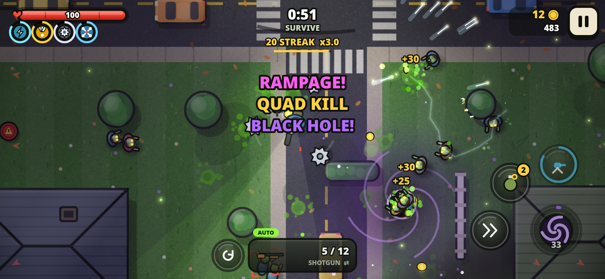
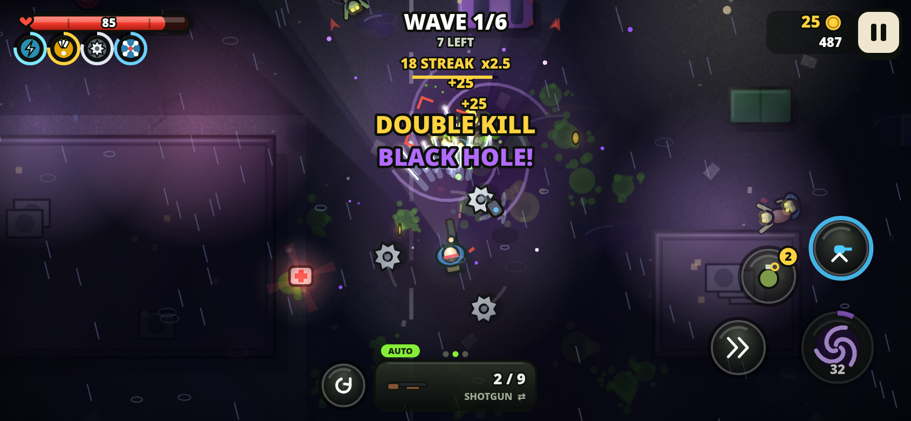
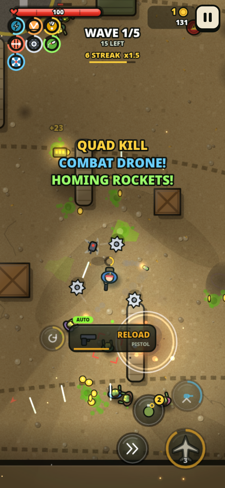
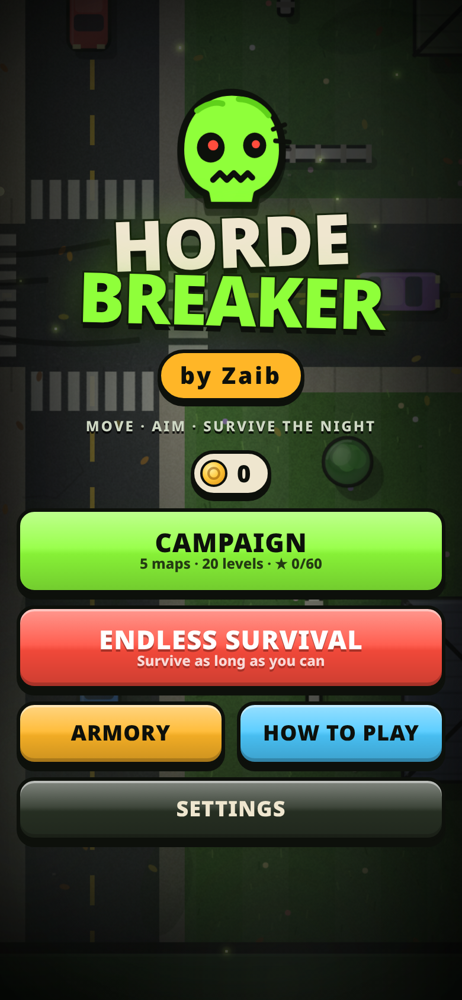

# Horde Breaker — by Zaib

A top-down zombie survival shooter for mobile browsers. Auto-fire is on by default: you move, and your gun locks onto the most dangerous zombie and keeps firing. Pick power cards between waves, unleash specials, survive five cursed maps and take down the bosses.

**Play:** https://wahidzeb.github.io/horde-breaker/

  

## Features
- **Campaign:** 5 maps and 20 levels: Suburbia, Dead Mall, St. Mercy Hospital, Fort Ashfall and Night City (rain and lightning). There are wave, timed-survival and boss levels. Each level has 3 stars and objectives such as finishing with high health, hitting a streak, getting explosion kills or keeping your accuracy up.
- **Endless survival:** play on any map. A boss arrives every 5 waves, and your best wave and score are saved for each map.
- **Zombies:** walkers, runners, brutes (with a telegraphed charge), acid spitters, exploding bloaters, lunging crawlers, and 5 named bosses that charge, slam, spit volleys and summon minions. The last few zombies of a wave go into a frenzy.
- **Power cards (roguelite):** after each cleared wave, and during survival levels, you pick 1 of 3 cards (Common, Rare or Epic). There are 19 perks that stack for the run, including Hollow Points, Quick Hands, Vampire, Orbital Saw, Drone Buddy, Static Rounds (chain lightning), Cryo Rounds, Twin Barrels and Second Wind.
- **Specials:** rechargeable abilities with a big cooldown-ring button. Kills make them recharge faster. **Air Strike** (bombing run on the biggest crowd), **Rage Mode** (fire rate, damage and life-steal), **Black Hole** (a vortex that drags zombies in, then implodes) and **Tesla Storm** (chain lightning from the sky). Unlock, equip and upgrade them in the Armory.
- **8 weapons:** pistol, shotgun, SMG, assault rifle, sniper (pierces), flamethrower, grenade launcher and minigun. Each has its own ammo and reload, and each can be upgraded for damage, fire rate, magazine size and reload speed. You also get grenades, a deployable auto-turret and a dash with brief invulnerability.
- **Pickups and power-ups:** ammo, health and coins, plus 15 power-ups: Chain Lightning, Ricochet, Multishot, Piercing Rounds, Saw Blades, Homing Rockets, Combat Drone, Time Warp, Magnet, Freeze Blast, Shockwave, Double Damage, Adrenaline, Invincible and Nuke. Explosive barrels are placed around the maps.
- **Armory:** buy, upgrade and equip a 3-weapon loadout. Survivor upgrades cover max HP, armor, move speed, grenade capacity, turret and scavenger luck.
- **Graphics (v1.1):** shaded, outlined characters with gradient lighting, soft shadows, walk sway, attack lunges, hit squash and collapse-and-fade death animations. Floors have grain and per-map decals (leaves and skid marks, glass shards, goo footprints, brass casings and craters, neon puddles), shaded props, drifting fog and ambient fireflies, dust, embers or rain splashes. The lighting uses soft glows: a flashlight cone with a volumetric beam, glowing tracers, fireball explosions with sparks and shock rings, and pickup halos with light rays. The HUD and menus are glossy, with a glowing logo and menu fog.
- **Polish:** glowing zombie eyes, muzzle flashes, cartoon goo (no gore), scorch marks, screen shake, kill-streak multipliers and multi-kill callouts. The title screen shows an animated live demo.
- **Audio:** all sound effects and music are generated with WebAudio. Groans are positional, and the music gets more intense as the horde grows. Bosses have their own theme.
- **Settings:** sound, music, vibration, screen shake, aim mode (Auto, the default; Assist; or Manual twin-stick), joystick type (Floating / Fixed), left-handed layout, graphics (Auto / High / Low) and reset progress.

## Controls
| Action | Touch | Keyboard / mouse |
|---|---|---|
| Move | Left joystick | WASD / arrow keys |
| Aim + fire | Automatic (touch the right side to aim manually) | Automatic, or hold the left mouse button to aim at the cursor |
| Special | Big corner button | C |
| Dash | Dash button | Space / Shift |
| Grenade | Grenade button | G / right-click |
| Turret | Turret button | E / F |
| Reload | Button beside the weapon panel | R |
| Pick a power card | Tap a card | 1–3 |
| Switch weapon | Tap the weapon panel | Q / Tab / 1–3 / mouse wheel |
| Pause | Pause button | P / Esc |

## Tech
- One self-contained `index.html` (Canvas 2D + vanilla JS) with no external assets.
- Mobile-first: fullscreen, works in portrait and landscape, supports multi-touch, blocks scrolling and zooming, and respects safe areas.
- Uses delta-time updates and lowers graphics quality automatically if the frame rate drops (Low turns off fog, vignette, soft shading and extra glows). The game pauses when the tab is hidden.
- Progress is saved in `localStorage`.

Game by **Zaib**.
